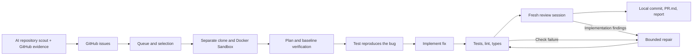

# Night Contributor

An overnight harness for preparing useful contributions to DeFi SDKs, frontend,
TypeScript, and Node.js libraries. The controller runs **on the host**, launches
Codex CLI in **Docker Sandboxes**, and leaves local branches, patches, logs, and
PR drafts for morning review.

The first version focuses on small bug fixes with reproducible tests. Separate,
fresh Codex sessions plan the work, reproduce the bug, implement a fix, and review
the result. The controller runs verification commands between these stages and
allows bounded repairs when final checks or review find an implementation defect.



## Run from the host

Run the commands below in a regular macOS/Linux terminal **outside the current
agent sandbox**. You can develop the harness and run `pnpm test` inside the
sandbox; the host must create the task sandboxes.

Requirements: Node.js 22+, pnpm, Git, an authenticated `gh`, and a working Docker
Sandboxes CLI (`sbx`). The pnpm version is pinned in the `packageManager` field
of `package.json`. If Corepack is available, enable pnpm with `corepack enable pnpm`.

```bash
pnpm install --frozen-lockfile
pnpm run build
pnpm run contrib doctor
```

`doctor` checks GitHub access, the commit author's name/email, and the Docker
Sandboxes commands. No sandbox needs to exist beforehand: the harness creates
one for each task. The ordinary `doctor` command inspects the sandbox CLI without
creating a sandbox.
For GitHub, run `gh auth login` on the host. An invalid `GH_TOKEN` or
`GITHUB_TOKEN` can override the login stored by `gh`.
The commit author comes from `git config user.name` / `git config user.email`
or the `author` configuration field. Use your name and an email linked to GitHub.

Configure Codex model access **for Docker Sandboxes**. Authentication for Codex
on the host does not automatically make it available inside a sandbox. Use the
authentication method supported by your Docker version, then check Codex once
in a separate working directory:

```bash
mkdir -p .contributor/auth-check
sbx run codex "$PWD/.contributor/auth-check"
```

Then check the automated execution path. This command creates a temporary
sandbox and makes a small, real model request:

```bash
pnpm run contrib doctor --probe
```

`sandbox.command` defaults to `["sbx"]`. For the legacy CLI, explicitly set it to
`["docker", "sandbox"]`. The command must match the CLI installed on the host;
`doctor` reports the selected command and its original error when it fails.
Update the command in any existing `contributor.local.json` as well.
OpenAI OAuth setup for `sbx` is described in the
[Docker documentation](https://docs.docker.com/ai/sandboxes/agents/codex/).
The harness does not automatically switch engines or run upstream commands on
the host.

## First overnight run

[contributor.config.json](contributor.config.json) includes viem, wagmi,
ethers.js, Uniswap SDKs, TanStack Query, Zustand, Zod, ky, ofetch, ufo, Fastify,
and Undici as pinned targets. AI repository discovery is enabled by default and
adds suitable libraries beyond this list. The harness checks current task
availability and each project's policies during execution.

First, inspect the settings and queue without network calls or model usage:

```bash
pnpm run contrib night --dry-run
```

To refresh candidate repositories and inspect discovered tasks before starting
the workers (the scout uses real model requests):

```bash
pnpm run contrib scout
pnpm run contrib discover
pnpm run contrib queue
pnpm run contrib run
```

For a normal overnight run with one command:

```bash
pnpm run night
```

`night` refreshes repository recommendations when due, processes the queue, and
refills it while work slots and run budgets remain. `scout` forces a repository refresh;
`discover` and `run` reuse the saved catalog without starting a new scout.

The scout uses two fresh Codex sessions in a scratch Docker Sandbox. The first
plans searches from `repositoryDiscovery.criteria` and `areas`. The host executes
the searches and fetches current metadata, language mix, README, contribution
instructions, and small issue/PR samples. The second session evaluates that
evidence and supplies reasons and source quotes. The host validates repository
identities, thresholds, and quotes before activating recommendations. Models
still judge semantic relevance and policy; task planning rechecks both.

Defaults: **1,000+ stars, a push within 180 days, JavaScript/TypeScript code,
6 queries with 10 results each, up to 12 candidate checks and 6 selected targets**.
The scout has a **30-minute deadline and a 200,000 soft token budget**, and its
usage counts toward the night budget. Recommendations refresh after **24 hours**
or changed settings. They live in `.contributor/repositories.json`; the pinned
config is not rewritten. Reports, rejected candidates and evidence are retained
in `.contributor/scouts/<id>/`. A failed refresh retains the previous compatible
catalog; cleanup failures require `recover`.
Successful rotation also preserves previously accepted queued work for execution;
new issue searches use only pinned targets and current recommendations.
See [repository discovery settings](docs/operations.md#ai-repository-discovery)
for exclusions, cache behavior and disabling the scout.

Discovery checks current issue activity and linked PRs before adding candidates
to the queue. It gives different repositories an initial share of queue slots,
then fills the remaining capacity. Defaults are up to **3 pages of 30 issues per
repository and 60 candidate checks per scan**. It skips scanning a full queue.
Screened rejections remain in history so later scans can get past them.
Within one night, refills reuse buffered candidates and continue from later pages,
up to **12 discovery rounds**, under the same token, time, and work attempt limits.
Repository scouting inspects up to **3 pages of 20 issues** and gives the model
the **5 highest-ranked eligible samples**; it can stop earlier when it has enough.

GitHub preflight checks each selected issue again. Eligibility skips and clean
planner declines are replaced from the queue, including from the same repository.
These skips consume neither the run's nor the repository's work attempt quota;
planning tokens and elapsed time still count. The offline dry run shows only the
initial selection; live checks and planning can change which issues proceed.
Subsequent runs use the saved history: failed attempts require explicit retry.
The `discovery.maxQueued` limit counts queued tasks only for repositories in the
active target set, including retained backlog during a night. Catalog rotation
keeps queued work eligible, with fresh issue preflight and policy checks. Removing
a pin, changing scout settings, or disabling scouting can make targets inactive;
their task history remains saved.
To select an issue manually, use `enqueue https://github.com/OWNER/REPO/issues/NUMBER`.
The repository must be pinned or in the active catalog, and the issue must be open, unassigned, and
have no known linked open PR.

Defaults: **2 concurrent tasks, up to 4 work attempts per night, one per repository,
6 hours per run, 75 minutes per task, 20 minutes per Codex session, and 15 minutes
per command**. Stopping and removing sandboxes can take additional time.
The diff limit is 12 files / 400 added and deleted lines.
Attempt quotas include failures and work that passes planning, including a
reproducer that later declines the task. Replacements stop when available search
results are exhausted or the run reaches its discovery, attempt, time, token, or GitHub limits. Four
work attempts do not guarantee four ready contributions.

`limits.maxRepairAttempts: 2` allows up to two fresh repair sessions within one
attempt after failed final tests or actionable reviewer findings. Repairs share
the original task deadline and night budget. The original regression files stay
unchanged; every repair reruns final checks and requires fresh reviewer approval.
Policy failures, invalid regression evidence, and checkout mutations by checks or
the reviewer remain terminal. Set the repair limit to `0` to disable repairs.

GitHub reads share a serial request queue, including preflight checks and every
page of issue context. Rate limits trigger a pause using `Retry-After` and quota
reset headers. Without those headers, retries wait 1, 2, 4, 8, and 16 minutes.
Temporary network failures and HTTP 5xx responses also receive bounded retries.
The cooldown is saved in `.contributor/github-cooldown.json` and respected after
a restart. Retry messages go to stderr, and all waits honor cancellation and the
applicable task/run deadline. See [GitHub request handling](docs/operations.md#github-request-handling).

`softTokenBudget: 2000000` stops new stages based on usage reported by completed
sessions. Sessions already running can exceed the limit; unfinished requests
may not report usage. This is **not a spending cap**. Configure spending limits
separately with the provider. `codex.model: null` uses the default model inside
the sandbox; explicitly select an available model for reproducibility.

Store personal configuration in the ignored `contributor.local.json`:

```bash
cp contributor.config.json contributor.local.json
pnpm run contrib night --config contributor.local.json
```

## Morning review

```bash
pnpm run contrib report
pnpm run contrib queue
```

Artifacts are stored in `.contributor/runs/<run>/<repo>-<issue>/`:

| File | Contents |
| --- | --- |
| `repo/` | Isolated checkout and local branch; includes a commit for `ready` tasks |
| `PR.md` | Reviewed PR title and body |
| `change.patch` | All changes, including new files |
| `regression.patch` | The regression test before the fix, which must have failed |
| `result.json` | Status, base/commit SHA, commands, exit codes, usage |
| `repair-N.json`, `review-repair-N.json` | Repair responses and subsequent independent reviews, when needed |
| `logs/` | Prompts, Codex JSONL, stderr, and command logs |
| `control/` | Context and evidence mounted read-only for agents |

`ready` means the baseline passed, the new test failed, checks passed after the
fix, a separate session approved the diff, the sandbox was removed, and a local
commit was created. Review the diff and PR draft before publishing manually.
Each final verification command must preserve the diff being checked. Changing
files during tests, lint, or generation stops the task before review and commit;
the agent must finish formatting and generating tracked code beforehand.
Earlier failed checks and reviews remain in the artifacts; numbered repair logs
and `control/repair-N.feedback.json` explain each additional round. The original
candidate and every repaired candidate are saved in `control/candidate*.patch`.
The run report
includes discovery rounds and the reason discovery stopped.
This status does not guarantee that a maintainer will accept the PR.

Publication is manual. Each sandbox's network policy blocks the GitHub API and
website, `origin` has a disabled push URL, and the controller implements only
GitHub reads. Before publishing, recheck that the issue is still relevant and
has no competing PR. Add your fork as a separate remote after reviewing the work.

## Scheduling and recovery

Generate schedule files on the host, using local time:

```bash
pnpm run contrib schedule --hour 1
```

On macOS, review the generated plist, then run:

```bash
launchctl bootstrap "gui/$(id -u)" "$PWD/.contributor/schedule/local.contributor.nightly.plist"
```

On Linux, add the line from `.contributor/schedule/night.cron` using `crontab -e`.
Both schedules preserve the PATH of the terminal that ran the generator.
Regenerate and reinstall the schedule after changing tool paths.
The generator does not install the schedule itself. The host and Docker must be
available overnight; ordinary cron does not run while the computer is asleep or
powered off.

After a crash:

```bash
pnpm run contrib recover
pnpm run contrib queue
pnpm run contrib retry 'owner/repo#123'
```

`recover` checks that the previous PID is no longer running, removes leftover
sandboxes, and marks attempts as interrupted. `retry` is allowed for
failed/skipped/interrupted tasks and preserves attempt history. During normal
execution, `Ctrl+C`/`SIGTERM` stops active processes and removes sandboxes.

Recovery writes `result.json` and updates reports for affected runs, including
completed ones. If cleanup fails, the attempt becomes `failed`, and `retry`
remains blocked until `recover` succeeds.

State and checkout roots are resolved to canonical paths on the host. Parent
directory symlinks, including `/var` on macOS, are supported. The guard against
replacing `.git` itself remains in place.

## Verification and limitations

```bash
pnpm test
```

Tests exercise real Git operations and a fixture bug locally, with controlled
adapters for Codex, Docker, and GitHub. They cover successful execution, false
reproductions, baseline/final check failures, test mutation, reviewer rejection
or changes, timeouts, locks, and cleanup. Check the real Docker/Codex integration
separately with `doctor --probe` on the host.

See [docs/operations.md](docs/operations.md) for the first version's scope and
operational details, and [docs/architecture.md](docs/architecture.md) for the
architecture.

The integration is based on [OpenAI Docs: non-interactive Codex](https://developers.openai.com/codex/noninteractive/),
[Docker Sandboxes](https://docs.docker.com/ai/sandboxes/), and the
[legacy docker sandbox CLI documentation](https://github.com/docker/docs/tree/f278dbfff4a3bb962dc9a2244eb6d71e4b6d7787/content/manuals/ai/sandboxes).
