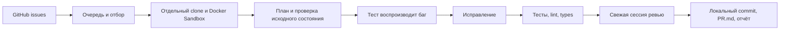

# Night Contributor

Harness для ночной подготовки полезных PR в DeFi SDK, Frontend, TypeScript и
Node.js библиотеки. Контроллер работает **на хосте**, запускает Codex CLI в
**Docker Sandboxes**, а утром оставляет локальные ветки, patch, логи и тексты PR.

Первая версия ориентирована на небольшие исправления багов с воспроизводимым
тестом. Отдельные свежие сессии Codex планируют, воспроизводят баг, исправляют его
и проводят ревью. Между ними контроллер самостоятельно выполняет проверки.



## Запуск с хоста

Команды ниже выполняются в обычном терминале Mac/Linux **снаружи текущей
песочницы агента**. Внутри песочницы можно разрабатывать harness и выполнять
`pnpm test`; создавать соседние песочницы должен хост.

Нужны Node.js 22+, pnpm, Git, авторизованный `gh` и работающий Docker Sandboxes CLI `sbx`.
Версия pnpm закреплена в `packageManager` в `package.json`. Если Corepack
доступен, активируй pnpm командой `corepack enable pnpm`.

```bash
pnpm install --frozen-lockfile
pnpm run build
pnpm run contrib doctor
```

`doctor` проверяет GitHub-доступ, имя/email автора коммита и команды Docker
Sandboxes. Заранее создавать песочницы не нужно: harness создаёт их сам для
каждой задачи; обычный `doctor` проверяет только CLI и не создаёт песочницу.
Для GitHub используй `gh auth login` на хосте. Если задан невалидный
`GH_TOKEN`/`GITHUB_TOKEN`, он может перекрывать сохранённый логин `gh`.
Автор берётся из `git config user.name` / `git config user.email` либо из
`author` в конфигурации. Укажи своё имя и email, связанный с GitHub.

Доступ Codex к модели нужно настроить **для Docker Sandboxes**. Авторизация
обычного Codex на хосте не означает, что она доступна внутри sandbox. Используй
поддерживаемый твоей версией Docker способ авторизации и один раз проверь запуск
Codex в отдельной рабочей директории:

```bash
mkdir -p .contributor/auth-check
sbx run codex "$PWD/.contributor/auth-check"
```

Затем проверь именно автоматизированный путь. Эта команда создаёт временную
песочницу и делает небольшой реальный запрос к модели:

```bash
pnpm run contrib doctor --probe
```

`sandbox.command` по умолчанию равен `["sbx"]`. Для старого CLI можно явно задать
`["docker", "sandbox"]`. Команда должна соответствовать установленному на хосте
CLI; `doctor` показывает выбранную команду и исходную ошибку при её сбое.
Если используешь ранее созданный `contributor.local.json`, обнови команду и в нём.
Настройка OpenAI OAuth для `sbx` описана в
[документации Docker](https://docs.docker.com/ai/sandboxes/agents/codex/).
Автоматической замены движка или запуска upstream-команд на хосте нет.

## Первая ночь

В [contributor.config.json](contributor.config.json) уже заданы viem, wagmi,
ethers.js, Uniswap SDKs, TanStack Query, Zustand, Zod, ky, ofetch, ufo, Fastify и
Undici. Это список кандидатов: текущую доступность задач и правила каждого
проекта harness проверяет при работе.

Сначала посмотри параметры и очередь без сетевых запросов и расходов на модель:

```bash
pnpm run contrib night --dry-run
```

Чтобы увидеть найденные задачи до запуска исполнителей:

```bash
pnpm run contrib discover
pnpm run contrib queue
pnpm run contrib run
```

Для обычного ночного запуска одной командой:

```bash
pnpm run night
```

`night` один раз обновляет очередь и обрабатывает выбранные задачи до лимита.
Повторные ночи используют историю: одна issue не запускается повторно сама.
Лимит `discovery.maxQueued` учитывает очередь только репозиториев из текущей
конфигурации. При удалении репозитория его задачи сохраняются, но не занимают
этот лимит и не запускаются; при возвращении репозитория снова доступны.
Для ручного выбора есть `enqueue https://github.com/OWNER/REPO/issues/NUMBER`.
Репозиторий должен входить в конфигурацию; issue должна быть открыта, свободна
и не иметь известного связанного открытого PR.

По умолчанию: **2 параллельные задачи, до 4 задач за ночь, одна на репозиторий,
6 часов на запуск, 75 минут на задачу, 20 минут на сессию Codex, 15 минут на
одну команду**. Завершение/удаление песочниц может занять дополнительное время.
Лимит diff — 12 файлов / 400 добавленных и удалённых строк.

`softTokenBudget: 2000000` останавливает новые этапы по usage завершённых сессий.
Уже работающие сессии могут превысить лимит; незавершённые запросы могут не
сообщить usage. Это **не денежный потолок**. Лимит расходов задаётся отдельно у
провайдера. `codex.model: null` использует модель по умолчанию внутри sandbox;
для воспроизводимости можно явно указать доступную тебе модель.

Личную конфигурацию можно хранить в игнорируемом `contributor.local.json`:

```bash
cp contributor.config.json contributor.local.json
pnpm run contrib night --config contributor.local.json
```

## Что будет утром

```bash
pnpm run contrib report
pnpm run contrib queue
```

Артефакты находятся в `.contributor/runs/<run>/<repo>-<issue>/`:

| Файл | Содержимое |
| --- | --- |
| `repo/` | Изолированный checkout и локальная ветка; для `ready` есть commit |
| `PR.md` | Заголовок и текст PR, прошедшие ревью |
| `change.patch` | Все изменения, включая новые файлы |
| `regression.patch` | Тест до исправления, который должен был упасть |
| `result.json` | Статус, base/commit SHA, команды, exit codes, usage |
| `logs/` | Prompts, JSONL Codex, stderr и логи команд |
| `control/` | Контекст и доказательства, доступные агентам только для чтения |

`ready` означает: исходное состояние прошло проверки; новый тест упал; после
исправления проверки прошли; отдельная сессия одобрила diff; песочница удалена;
создан локальный commit. Просмотри diff и текст перед ручной публикацией.
Каждая финальная проверка должна сохранять проверяемый diff. Изменение файлов
во время теста, lint или генерации останавливает задачу до ревью и коммита;
форматирование и генерацию отслеживаемого кода агент завершает заранее.
Принятие PR мейнтейнером этот статус не гарантирует.

Публикация остаётся ручной. GitHub API/сайт блокируются сетевой политикой каждой
песочницы, `origin` имеет отключённый push URL, а у контроллера реализованы
только чтения GitHub. Перед публикацией ещё раз проверь актуальность issue и
отсутствие конкурирующего PR. Подключи свой fork отдельным remote после просмотра.

## Расписание и восстановление

Генерация файлов расписания на хосте, по местному времени:

```bash
pnpm run contrib schedule --hour 1
```

Для macOS после просмотра сгенерированного plist:

```bash
launchctl bootstrap "gui/$(id -u)" "$PWD/.contributor/schedule/local.contributor.nightly.plist"
```

Для Linux добавь строку из `.contributor/schedule/night.cron` через `crontab -e`.
Оба расписания сохраняют PATH терминала, в котором запущен генератор. После
изменения путей к инструментам сгенерируй и установи расписание заново.
Генератор сам расписание не устанавливает. Хост и Docker должны быть доступны
ночью; спящий/выключенный компьютер не выполняет обычный cron.

После аварийного завершения:

```bash
pnpm run contrib recover
pnpm run contrib queue
pnpm run contrib retry 'owner/repo#123'
```

`recover` проверяет, что старый PID не работает, удаляет оставшиеся песочницы и
помечает попытки прерванными. `retry` разрешён для failed/skipped/interrupted,
история попыток сохраняется. `Ctrl+C`/`SIGTERM` при обычной работе инициируют
остановку текущих процессов и удаление песочниц.

Восстановление записывает `result.json` и обновляет отчёты затронутых запусков,
включая уже завершённые. Если очистка не удалась, попытка получает `failed`,
а `retry` остаётся заблокирован до успешного `recover`.

Корни состояния и checkout приводятся к каноническим путям на хосте: каталоги
через симлинки, в том числе `/var` на macOS, поддерживаются. Проверка подмены
самого `.git` сохраняется.

## Проверки и ограничения

```bash
pnpm test
```

Тесты выполняют реальный цикл Git и тестовый баг на локальных fixtures, а
Codex/Docker/GitHub заменяют контролируемыми адаптерами. Проверяются успешный
сценарий, ложное воспроизведение, провал baseline/final checks, изменение теста,
отклонение/изменения ревьюера, таймауты, блокировки и очистка. Реальная интеграция
Docker/Codex проверяется отдельно командой `doctor --probe` с хоста.

Функциональность первой версии и эксплуатационные детали:
[docs/operations.md](docs/operations.md), устройство:
[docs/architecture.md](docs/architecture.md).

Интеграция основана на [OpenAI Docs: non-interactive Codex](https://developers.openai.com/codex/noninteractive/),
[Docker Sandboxes](https://docs.docker.com/ai/sandboxes/) и
[документации старого CLI docker sandbox](https://github.com/docker/docs/tree/f278dbfff4a3bb962dc9a2244eb6d71e4b6d7787/content/manuals/ai/sandboxes).
